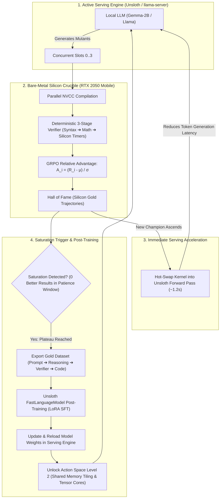

# Autonomous Flywheel Architecture: RLVR Crucible ➔ Post-Training ➔ Serving Engine Acceleration

## 1. The Recursive Acceleration Loop

---

## 2. Key Pillars of the System

### Pillar A: The Serving Engine is the First Beneficiary
When an agent evolves a faster kernel (e.g. `10.28 µs` Flash-Decoding or `11.49 µs` MLP Softmax):
- It is **not** kept in isolation.
- It is **immediately hot-swapped into the serving engine** running the model.
- Because the serving engine's forward pass becomes faster, **token generation throughput increases**.
- Higher token throughput means the agent can generate and evaluate **more mutants per minute**, accelerating subsequent breakthroughs.

### Pillar B: Automated Saturation Detection
- The engine monitors improvement deltas over a sliding window (`patience_rounds` or 24-hour cycle).
- If $\Delta \text{Reward} = 0$ across the patience window, the local search space is mathematically exhausted (entropy collapse / logit saturation).
- The system automatically triggers the **Self-Distillation Post-Training Phase**.

### Pillar C: "Silicon Gold" Post-Training
Instead of training on unverified internet text, the model is trained strictly on **ground-truth verified trajectories**:
1. **Input Context**: Hardware parameters (GA107, 16 SMs, 48KB L1 cache, target latency).
2. **Chain of Thought**: Architectural rationale that produced the victory.
3. **Verified Code**: Code that compiled with zero errors and zero numerical drift.
4. **Hardware Proof**: Microsecond measurements from bare silicon.

### Pillar D: Action Space Level Progression
After the model internalizes the winning patterns through post-training, the crucible unlocks the next architectural tier:
- **Level 1 (Current)**: Micro-architecture (Unrolling, Cache Streaming `ld.global.cs`, PTX FMA `fma.rn.f32`, Register Caps).
- **Level 2 (Next)**: Shared Memory Bank Conflict Resolution (`__shared__`, warp swizzling).
- **Level 3 (Elite)**: Ampere Asynchronous Memory Transfers (`cp.async`) and Tensor Core WMMA/MMA operations.
