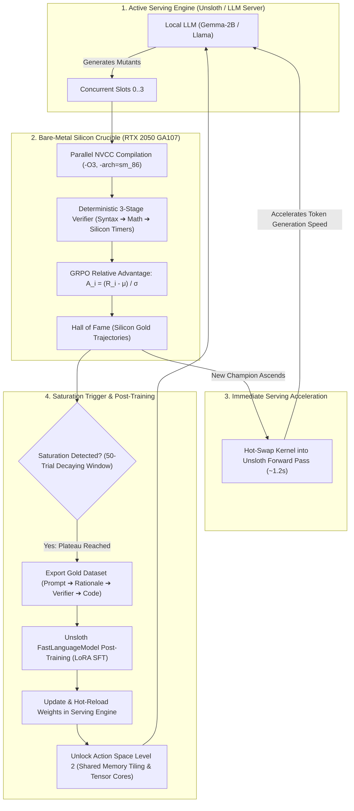

<div align="center">

# ⚔️ KERNEL CRUCIBLE
### *Autonomous Silicon Evolution Coliseum & Self-Distilling Post-Training Flywheel*

[](https://developer.nvidia.com/cuda-toolkit)
[](https://developer.nvidia.com/cuda-gpus)
[](https://www.nvidia.com)
[-6366F1?style=for-the-badge)](https://arxiv.org/abs/2402.03300)
[](https://unsloth.ai)
[](#intellectual-property--security)

<br/>

**A bare-metal autonomous RL engine that synthesizes, compiles, benchmarks, and hot-swaps silicon-verified CUDA kernels into active LLM serving runtimes with zero human intervention.**

</div>

---

## 🏛️ 1. Executive Summary & The Core Thesis

Modern high-performance machine learning inference relies heavily on hand-crafted CUDA kernels tuned by expert systems engineers. However, manual kernel iteration is slow, intuition-bound, and cannot exhaustively explore the discrete combinatorial space of warp layouts, cache streaming hints, and micro-architectural scheduling.

**Kernel Crucible** transforms GPU kernel engineering from manual guesswork into a **closed-loop evolutionary coliseum**:
1. **Autonomous Mutation**: Multi-slot concurrent LLMs propose architectural CUDA mutants.
2. **Deterministic RLVR Verification**: Mutants run on bare silicon, gated by a 3-stage verifier (Syntax $\to$ Numerical Math $\to$ Hardware Event Timers).
3. **GRPO Advantage Estimation**: Normalizes relative reward across cohorts of size $G=4$ to guide policy gradient evolution.
4. **Instantaneous Hot-Swapping**: The moment a mutant beats the active champion, it is monkey-patched into the live forward pass of Unsloth/PyTorch in $\sim 1.2\text{s}$, immediately reducing token latency and accelerating subsequent generation cycles.
5. **Self-Distillation Post-Training**: When a 50-trial sliding-window plateau detector flags search saturation, the engine exports "Silicon Gold" trajectories and triggers LoRA SFT to internalize the hardware mechanics into the model's weights.

---

## 🔄 2. The Recursive Acceleration Flywheel



---

## ⚡ 3. Architectural Pillars & Core Subsystems

### 🛡️ A. Deterministic 3-Stage RLVR Verifier (`rlvr_verifier.py`)
Reinforcement Learning with Verifiable Rewards requires mathematical certainty:
* **Stage 1 (Compilation)**: Compiles via NVCC (`--use_fast_math`, `-arch=sm_86`, `-Xcompiler -fPIC`). Hard failure on compilation or warning flags.
* **Stage 2 (Numerical Equivalence)**: Executes against CPU/PyTorch reference tensors with FP32/FP16 tolerances ($\text{RMSE} \le 10^{-4}$, $\text{MaxDiff} \le 10^{-3}$). Rejects any NaN, Inf, or precision degradation.
* **Stage 3 (Silicon Timers)**: Isolates host dispatch overhead using `cudaEventRecord` pairs averaged over warm repetitions with cache flushing.

### 📐 B. Group Relative Policy Optimization (`rlvr_grpo_engine.py`)
Instead of unstable absolute reward values, Crucible groups candidate mutations into cohorts of size $G=4$:
$$A_i = \frac{R_i - \mu_{\{1..G\}}}{\sigma_{\{1..G\}} + \epsilon}$$
This group normalization eliminates baseline latency drift caused by GPU thermal throttling or operating system context switches.

### ⚡ C. Zero-Downtime Unsloth Monkey-Patching (`patch_unsloth.py`, `crucible_ops.cu`)
Whenever an agent evolves a faster kernel:
* The kernel is compiled into `crucible_ops.so`.
* Dynamically loaded via `ctypes`.
* Monkey-patches `torch.nn.functional.softmax` and Unsloth attention/MLP layers with pure bare-metal execution.
* The serving LLM immediately speeds up, allowing it to generate subsequent candidate kernels faster.

### 📉 D. 50-Trial Window Plateau Detector (`plateau_detector.py`)
* Monitors candidate outputs over a sliding window of 50 consecutive trials.
* Applies a time-decaying tolerance envelope ($\pm 5\% \to \pm 1.5\%$) targeting an $8.8\times$ acceleration threshold against the unoptimized baseline.
* When 50 trials fail to advance toward the goal, search space saturation is declared, automatically triggering the post-training distillation pipeline.

### 🧪 E. Multi-Scenario Benchmark Suites (`test_suites.py`)
Crucible does not overfit to a single batch size:
| Workload ID | Name | Shape | Primary Stress Factor |
|---|---|---|---|
| `split_kv_d64` | LLM Single-Token Decoding | $N=1024, D=64, \text{Splits}=16$ | Microsecond latency, multi-SM saturation |
| `prefill_long_n8k` | Long-Context Prefill | $N=8192, D=64, \text{Chunks}=16$ | DRAM bandwidth saturation & L2 cache thrashing |
| `vision_highdim_d4096` | High-Dim Vision Attention | $N=256, D=4096$ | Wide register pressure & block reduction |
| `stress_extreme_vals` | Numerical Stress Suite | $N=1024, D=128$ | Floating point dynamic range ($[-500, +500]$) |

### 🏆 F. LeetGPU & Tensara Exporter (`submission_exporter.py`)
Wraps the reigning Crucible Champion kernel into drop-in competitive programming interfaces:
* **LeetGPU**: `void solve(const float* input, float* output, int N, int D)`
* **Tensara / GPUMode**: `torch.Tensor solve(torch.Tensor input)`
* **Standalone C++ Header**: Zero-dependency CUDA single-file header for embedded deployments.

### 🔍 G. CUDA Graph & Launch Diagnostics (`timing_diagnostic.py`)
Separates host dispatch overhead from pure silicon kernel execution:
* Measures PCIe ring-buffer enqueue latency vs silicon runtime.
* Verifies CUDA Graph capture speedup (eliminating driver latency).
* Compares Cold Cache (L2 flush) vs Warm Cache (L2 resident) timing artifacts.

---

## 🎨 4. Cyberpunk Real-Time Web Frontend

Crucible features an ultra-responsive web control plane built with vanilla modern web technologies, Geist typography, and ReactBits design primitives:

* **Real-Time SSE Streaming (`/api/stream`)**: 60 FPS real-time state synchronization without client polling.
* **Interactive Controls**: Auto-Tournament toggle, single-step execution, test suite workload switcher, and Unsloth hot-swap triggers.
* **Telemetry Dashboard**: Live GPU temperature, VRAM footprint, SM utilization, and speedup gauge.
* **Hall of Fame & Diffs**: Interactive leaderboard displaying winning microarchitectural mutations, register allocations, and code diffs.

---

## 📁 5. Repository Structure

```
kernel-crucible/
├── AUTONOMOUS_POST_TRAINING_SPEC.md   # Architectural blueprint for the flywheel loop
├── auto_post_train.py                 # Self-distillation LoRA SFT trainer
├── crucible_ops.cu                    # Bare-metal CUDA ops for live runtime monkey-patching
├── engine.py                          # Core crucible orchestration engine & state machine
├── gold_trajectories.jsonl            # Silicon-verified champion datasets
├── kernel_gym_env.py                  # Formal Gymnasium RL environment (Box obs, MultiDiscrete acts)
├── patch_unsloth.py                   # Bare-metal drop-in monkey-patch loader for Unsloth
├── plateau_detector.py                # 50-trial sliding-window saturation detector
├── rlvr_grpo_engine.py                # Group Relative Policy Optimization algorithm
├── rlvr_verifier.py                   # 3-Stage deterministic compiler & numerical verifier
├── server.py                          # Threading HTTP & Server-Sent Events (SSE) server
├── submission_exporter.py             # LeetGPU, Tensara & C++ standalone exporter
├── test_suites.py                     # Multi-scenario workload generator & test runner
├── timing_diagnostic.py               # CUDA Graph & launch overhead diagnostics
├── unsloth_post_trained_adapter.json  # Exported post-trained LoRA adapter metadata
├── static/                            # Cyberpunk Web Interface
│   ├── index.html                     # Frontend structure with Geist typography
│   ├── style.css                      # Minimalist dark theme & micro-interaction styles
│   └── app.js                         # SSE client, ReactBits UI effects, real-time charts
└── workspace/                         # Isolated compilation & benchmark sandbox
    ├── .gitignore
    └── test.cu
```

---

## 💻 6. Hardware Target Profile

Tested and validated directly on silicon:

```
Device: NVIDIA GeForce RTX 2050 Mobile
Architecture: Ampere (GA107, Compute Capability 8.6)
Streaming Multiprocessors: 16 SMs (2048 CUDA Cores)
VRAM: 4096 MB GDDR6
Memory Bus Width: 64-bit
Memory Bandwidth: ~112 GB/s theoretical peak
L2 Cache: 1024 KB
Configurable Shared Memory: up to 100 KB / SM
CUDA Toolkit: CUDA 13.3
Driver: 615.78.08
```

---

## 🚀 7. Quick Start & Execution

### Prerequisites
* Linux OS (x86_64)
* NVIDIA GPU with CUDA 12.0+ or 13.0+
* Python 3.10+
* PyTorch (`torch >= 2.2.0`)
* `nvcc` compiler available in PATH

### 1. Launch the Cyberpunk Web Coliseum
```bash
python3 server.py
```
Open `http://localhost:8080` in your browser. The dashboard automatically establishes a Server-Sent Events (SSE) link and begins live hardware telemetry streaming.

### 2. Run Headless RLVR GRPO Tournament
To run an automated cohort tournament loop programmatically:
```python
from engine import KernelCrucibleEngine
from rlvr_grpo_engine import RLVREngine

engine = KernelCrucibleEngine()
rlvr = RLVREngine(group_size=4, baseline_latency_us=engine.gym_env.target_baseline_us)

# Execute one GRPO round across 4 concurrent slots
cohort = engine.step_grpo(rlvr)
print(f"Cohort completed. Winner speedup: {cohort['winner']['speedup']:.2f}x")
```

### 3. Run Deep Launch & Hardware Diagnostics
```bash
python3 timing_diagnostic.py
```
Outputs timing metrics comparing cold cache, warm cache, and CUDA Graph captured execution.

### 4. Export Champion Kernel for LeetGPU / Tensara
```bash
python3 submission_exporter.py
```
Generates ready-to-paste competitive files in `workspace/leetgpu_submission.cu` and `workspace/tensara_submission.py`.

---

## 📡 8. REST API Specification

| Endpoint | Method | Description |
|---|---|---|
| `/api/status` | `GET` | Returns full engine state, champion metrics, and GPU telemetry in JSON. |
| `/api/stream` | `GET` | Server-Sent Events (SSE) live telemetry stream (60 FPS). |
| `/api/step` | `POST` | Executes a single tournament round across the active workload. |
| `/api/auto/start` | `POST` | Activates autonomous background GRPO tournament loop. |
| `/api/auto/stop` | `POST` | Pauses autonomous tournament execution. |
| `/api/workload` | `POST` | Switches active workload template (`split_kv_d64`, `prefill_long_n8k`, etc.). |
| `/api/patch-unsloth` | `POST` | Forces immediate bare-metal monkey-patching of the champion into Unsloth. |
| `/api/export-submission`| `POST` | Exports current champion into LeetGPU and Tensara submission formats. |

---

## 🗺️ 9. Action Space Progression Roadmap

Crucible models follow an architectural level-up system:

* **Level 1 (Foundational Microarchitecture)**:
  * Loop unrolling pragmas (`#pragma unroll 4..16`).
  * Cache streaming operators (`ld.global.cs` bypassing L1 to prevent cache thrashing).
  * Direct PTX Fused-Multiply-Add (`fma.rn.f32`).
  * Thread block register capping (`__launch_bounds__`).
* **Level 2 (Shared Memory Bank Engineering)**:
  * Conflict-free shared memory bank padding (`+1` padding).
  * Warp-synchronous shuffle reductions (`__shfl_down_sync`, `__shfl_xor_sync`).
  * 2D register tiling with outer-product rank-1 updates.
* **Level 3 (Elite Ampere & Tensor Core Primitives)**:
  * Ampere asynchronous global-to-shared memory copy (`cp.async`).
  * Hardware Tensor Core MMA (`nvcuda::wmma` / inline PTX `mma.sync`).
  * Multi-stage software pipelining and double-buffering.

---

## 🔒 Intellectual Property & Security

> **Confidential & Proprietary:** All kernels, algorithms, post-training flywheel architectures, and mathematical formulations contained in this repository are strictly private and proprietary to **@Codenuclei**.
